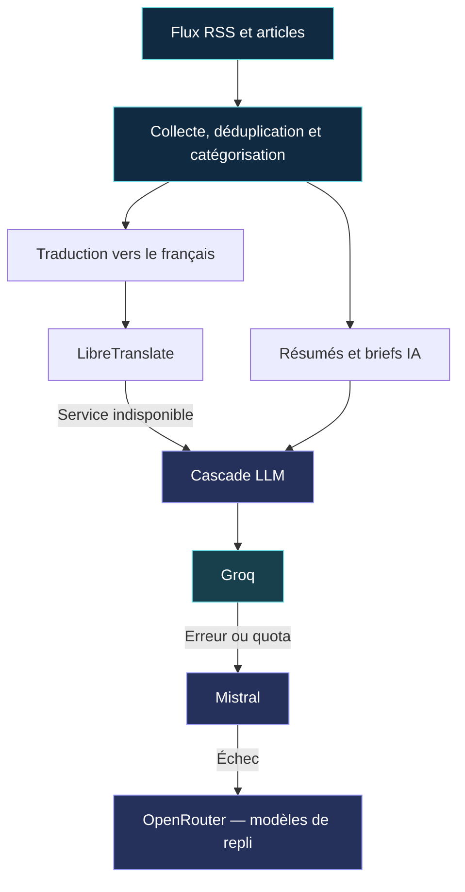

<div align="center">


<br />

### Votre centre de veille technologique, augmenté par l'IA.

**Une seule interface pour suivre la tech, comprendre les tendances et garder une longueur d'avance.**

Agrégation RSS · Briefs IA · Cybersécurité · Vidéos · Fuites de données

<br />

[](https://nodejs.org/)
[](https://react.dev/)
[](#-déploiement-avec-docker)
[](#-déploiement-avec-docker)
[](https://github.com/neosoda/news/commits/main)

<br />

[**Découvrir les fonctionnalités**](#-une-veille-qui-va-à-lessentiel) · [**Installer avec Docker**](#-déploiement-avec-docker) · [**Comprendre l'architecture**](#-architecture) · [**Explorer l'API**](#-api-rest)

<sub>Projet développé par <a href="https://github.com/neosoda">neosoda</a> · React + Express + Prisma · Déployable sur Docker et Coolify</sub>

</div>

---

## ✨ Une veille qui va à l'essentiel

L'information technologique est partout. Le temps pour la lire, beaucoup moins.

**NewsAI** centralise des sources d'actualité tech, IA, cloud, développement et cybersécurité. Le moteur collecte les flux RSS, déduplique les articles, les traduit si nécessaire et permet de produire des synthèses assistées par IA.

L'objectif : **passer moins de temps à chercher l'information et plus de temps à la comprendre.**

| | Espace | Ce que vous y trouvez |
|:---:|---|---|
| 📰 | **Actualités** | Flux RSS consolidé, classement, recherche, catégories, statistiques et défilement continu. |
| ⚡ | **Brief IA quotidien** | Synthèses structurées par thème, avec points clés et renvois vers les articles sources. |
| 🛡️ | **Fuites de données** | Espace dédié aux alertes publiées par Bonjour la fuite, Fuites Infos et FrenchBreaches. |
| 🎬 | **Vidéos** | Veille IA, IT, tech et développement depuis des chaînes YouTube via leurs flux. |
| 🔖 | **Favoris** | Mise de côté des articles à retrouver plus tard. |
| 📡 | **Sources RSS** | Ajout et suppression de sources, état de santé des flux, relance et réactivation, sous accès administrateur. |

<sub>Interface responsive avec thème clair/sombre ; les fonctions IA nécessitent au moins une clé de fournisseur configurée.</sub>

## 🧠 Une intelligence artificielle avec des solutions de repli

NewsAI utilise plusieurs fournisseurs pour éviter de dépendre d'un seul moteur.



**Ordre de priorité :** Groq → Mistral → OpenRouter. Les modèles gratuits OpenRouter sont utilisés en cascade lorsque ce fournisseur est configuré. Pour les traductions, **LibreTranslate** est essayé avant le repli sur LLM.

Cette stratégie améliore la résilience, **sans garantir** la disponibilité, la gratuité ni l'exactitude des réponses des services tiers.

## 🔍 Ce qui se passe en coulisses

<details>
<summary><strong>Voir les détails du moteur de veille</strong></summary>

<br />

- **Collecte planifiée** : récupération des flux au démarrage, puis toutes les **15 minutes** tant que le serveur fonctionne.
- **Catalogue initial** : sources technologiques et sécurité préconfigurées ; initialisation idempotente sans effacer les articles existants.
- **Déduplication** : normalisation des URL, empreintes de contenu SHA-256 et rapprochement de titres pour limiter les republications.
- **Traitement de contenu** : récupération d'images lorsqu'elle est possible, correction de problèmes d'encodage et traduction en français.
- **Résilience des sources** : suivi des échecs, périodes de pause, désactivation après échecs répétés et possibilité de réactivation.
- **Contrôle éditorial** : les fuites de données restent dans leur rubrique dédiée plutôt que d'encombrer le fil principal.

</details>

## 🚀 Déploiement avec Docker

Le moyen le plus simple pour lancer NewsAI, y compris depuis un environnement **Coolify**.

**Prérequis :** Docker avec Compose, un jeton d'administration robuste et **au moins une clé API LLM** pour les fonctionnalités IA (Groq, Mistral ou OpenRouter).

### 1. Récupérer le dépôt

```bash
git clone https://github.com/neosoda/news.git
cd news
cp server/.env.example .env
```

### 2. Configurer `.env`

Définissez un jeton `ADMIN_TOKEN` aléatoire d'au moins **32 caractères** et au moins une clé LLM :

```dotenv
# Obligatoire pour l'administration des sources
ADMIN_TOKEN=remplacer_par_un_jeton_aleatoire_de_32_caracteres_minimum

# Au moins une clé pour les fonctions IA
GROQ_API_KEY=
MISTRAL_API_KEY=
OPENROUTER_API_KEY=

# Instance de traduction par défaut (personnalisable)
TRANSLATION_URL=https://translate.techsentinel.fr/translate
```

Pour générer un bon jeton :

```bash
openssl rand -base64 48
```

> **Sécurité :** ne publiez jamais votre `.env` ni vos clés API. Le point de traduction par défaut est un service externe au conteneur ; vous pouvez le remplacer par votre propre instance LibreTranslate.

### 3. Lancer l'application

```bash
docker compose up -d --build
```

Ouvrez **http://localhost:8080**.

Le conteneur initialise Prisma/SQLite et charge les sources par défaut au démarrage. Le volume nommé `news-data` conserve la base SQLite lors de la recréation du conteneur.

**Pour Coolify :** importez le dépôt Git, utilisez le déploiement Docker Compose, configurez les variables d'environnement dans Coolify et exposez le service sur le port interne `3000`.

## 💻 Développement local

<details>
<summary><strong>Installation Node.js sans Docker</strong></summary>

<br />

Prévoir **Node.js 20+**, npm et un accès réseau vers les fournisseurs configurés.

Dans un premier terminal :

```bash
git clone https://github.com/neosoda/news.git
cd news/server
cp .env.example .env
# Renseignez ADMIN_TOKEN et au moins une clé LLM dans .env
npm ci
npx prisma generate
npx prisma db push
npx prisma db seed
npm run dev
```

Dans un deuxième terminal, depuis la racine du dépôt :

```bash
cd client
npm ci
npm run dev
```

Le frontend Vite s'ouvre sur **http://localhost:5173** et redirige les requêtes `/api` vers l'API locale sur le port `3000`.

**Vérifications disponibles :**

```bash
cd server && npm test
```

```bash
cd client && npm run lint && npm run build
```

</details>

## 🏗️ Architecture

Un backend chargé de la collecte et des traitements, un frontend léger centré sur la lecture.

| Couche | Technologies | Rôle |
|---|---|---|
| **Interface** | React 19, Vite 7, Tailwind CSS, TanStack Query | Lecture, recherche, navigation, briefs, favoris et administration. |
| **API** | Node.js 20, Express 5 | Endpoints, accès aux données et contrôle des requêtes. |
| **Veille** | rss-parser, node-cron, Cheerio | Ingestion, nettoyage, enrichissement et planification des flux. |
| **Données** | SQLite, Prisma 5 | Articles, sources, favoris et cache des briefs. |
| **IA / traduction** | Groq, Mistral, OpenRouter, LibreTranslate | Synthèse, catégorisation et traduction avec stratégies de repli. |
| **Déploiement** | Docker, Docker Compose | Conteneur applicatif et stockage persistant. |

```text
news/
├── client/                   # Interface React / Vite
│   └── src/
│       ├── pages/            # Actualités, brief, vidéos, fuites...
│       ├── components/       # Layout et cartes
│       └── services/         # Client API et parsing du brief
├── server/                   # API et traitements
│   ├── prisma/               # Schéma SQLite et seed RSS
│   ├── services/             # RSS, IA, sécurité, vidéos, déduplication
│   ├── routes.js             # API REST
│   └── index.js              # Serveur et actualisation planifiée
├── docs/assets/              # Identité visuelle GitHub
├── Dockerfile
└── docker-compose.yml
```

## 🔌 API REST

Quelques endpoints utiles pour superviser ou intégrer NewsAI :

| Méthode | Route | Utilité |
|---|---|---|
| `GET` | `/api/health` | État de l'API, de SQLite et de l'actualisation RSS |
| `GET` | `/api/articles` | Articles, recherche, pagination et filtres |
| `GET` | `/api/articles/stats` | Statistiques de la veille |
| `GET` | `/api/daily-brief` | Brief IA quotidien |
| `GET` | `/api/videos` | Vidéos par thème et mots-clés |
| `GET` | `/api/bookmarks` | Articles favoris |
| `POST` | `/api/articles/:id/summarize` | Résumé IA d'un article |
| `GET` | `/api/sources/health` | État des sources (**jeton admin obligatoire**) |
| `POST` | `/api/sources/refresh` | Demande d'actualisation (**jeton admin obligatoire**) |

Les autres opérations de gestion des sources utilisent également le jeton `X-Admin-Token`. L'accès public à certains endpoints de lecture et les favoris est propre à l'application telle qu'elle est conçue : **n'exposez pas cette instance sans évaluer votre modèle de sécurité**.

## 🔐 Sécurité et exploitation

- **Administration des sources protégée** par `ADMIN_TOKEN`, transmis dans l'en-tête `X-Admin-Token` et gardé en `sessionStorage` côté navigateur.
- **Validation des URL** des sources et protections contre certaines requêtes SSRF, restriction CORS et limitation du nombre de requêtes sur les opérations concernées.
- **Données persistantes** dans SQLite : sauvegardez le volume Docker avant toute migration importante.
- **Fonctionnement dépendant des tiers** : la collecte, YouTube, la traduction et la génération IA dépendent de la disponibilité des services contactés.
- **Synthèses IA à vérifier** : les briefs facilitent la lecture mais les articles originaux restent la référence.

## 🤝 Participer au projet

Une idée de fonctionnalité, un problème de collecte RSS, une correction d'interface ou une amélioration à proposer ?

[**Signaler un problème**](https://github.com/neosoda/news/issues) · [**Proposer une contribution**](https://github.com/neosoda/news/pulls) · [**Explorer le code**](https://github.com/neosoda/news)

<sub>Le dépôt public ne fournit pas actuellement de fichier LICENSE à sa racine : vérifiez les conditions de réutilisation auprès du mainteneur avant redistribution.</sub>

---

<div align="center">

**NewsAI — Moins de bruit. Plus de signal.** ✦

<sub>Made by <a href="https://github.com/neosoda">neosoda</a> · Pensé pour les passionnés de tech, les développeurs et les professionnels IT.</sub>

<br /><br />

<a href="https://github.com/neosoda/news#readme">↑ Retour en haut</a>

</div>
